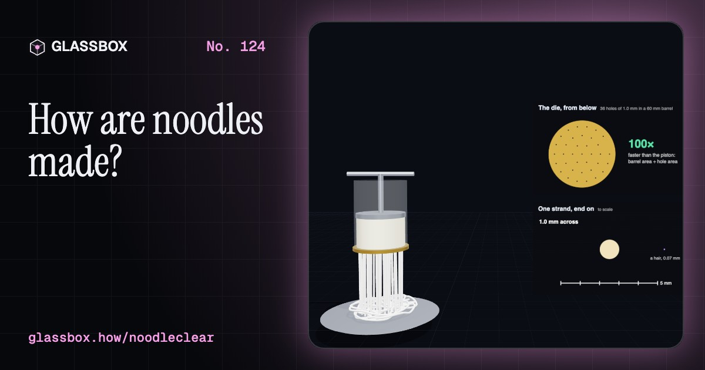
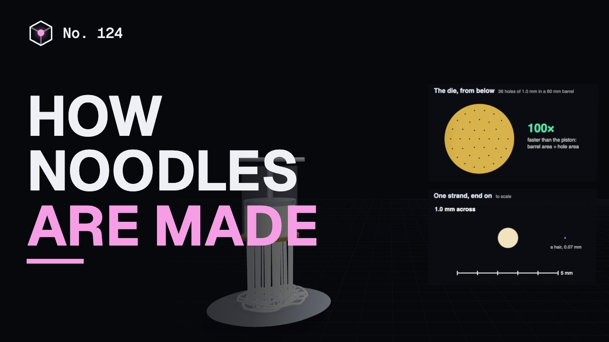
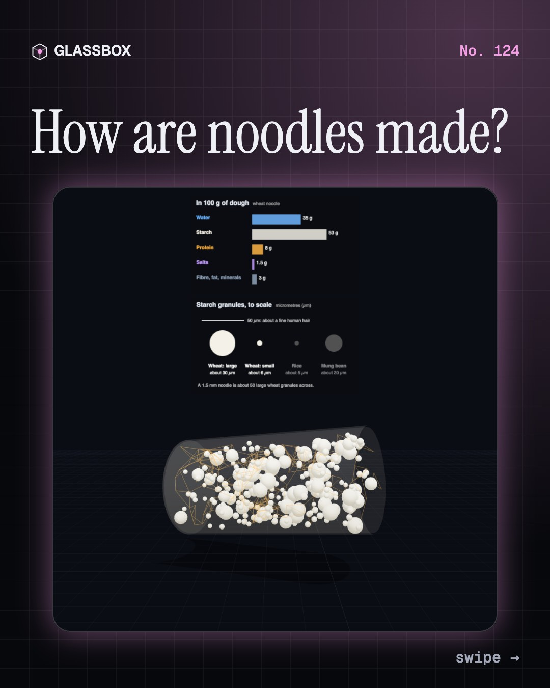
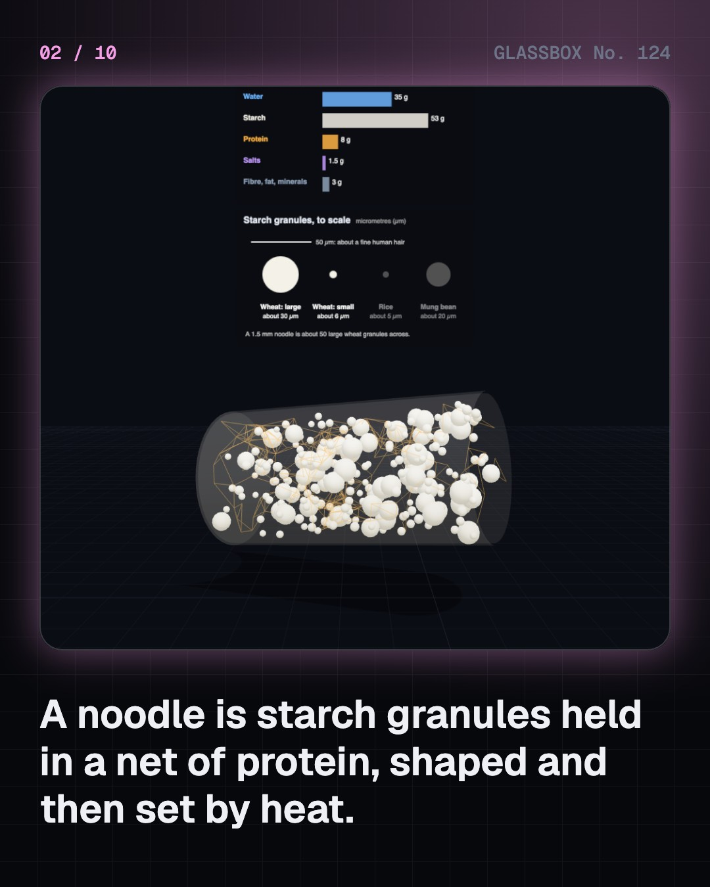
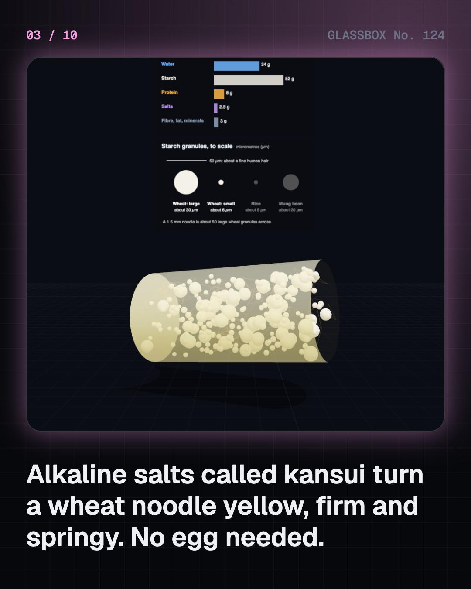
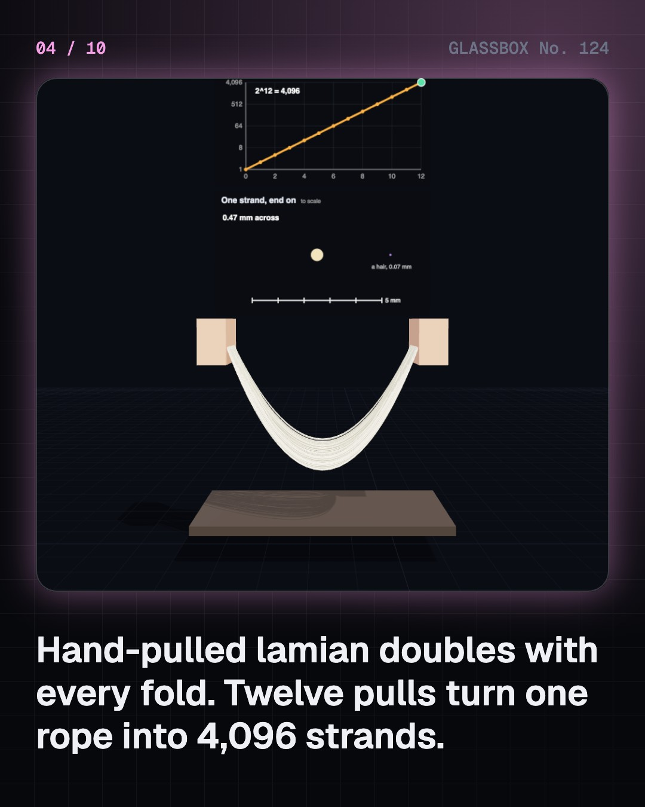

<!-- glassbox:start -->
<!-- Generated from glassbox.json by the Glassbox hub (npm run readme -- noodleclear). Edit glassbox.json, not this block. -->
<p align="center"><a href="https://glassbox.how/e/noodleclear/"></a></p>

<h1 align="center">NoodleClear</h1>

<p align="center"><b>How are noodles made?</b><br>A noodle is starch held in a net, pressed into a thread and set by heat. Pull one rope of dough into 4,096 strands, cook a strand from the outside in, then run an instant noodle line: steam, wave, and a minute in 150 °C oil that leaves every strand full of pores.</p>

<p align="center"><a href="https://glassbox.how/noodleclear/"><b>▶ Play with it</b></a> &nbsp;·&nbsp; <a href="https://glassbox.how/e/noodleclear/">Read the 60-second explainer</a> &nbsp;·&nbsp; <a href="https://glassbox.how/noodleclear/glassbox/reel.mp4">Watch the 40-second video</a></p>

<p align="center">
  <a href="https://glassbox.how/e/noodleclear/"></a>
  <a href="https://glassbox.how/e/noodleclear/"></a>
  <a href="LICENSE"></a>
  <a href="LICENSE-CONTENT.md"></a>
  <a href="#privacy"></a>
</p>

## In 60 seconds

1. **Starch in a net.** Flour is mostly hard starch granules. In wheat noodles a stretchy net of gluten holds them. Kansui, an alkaline salt mix, makes ramen-type noodles yellow, firm and springy. Rice has no gluten, so idiyappam and sevai are set by steaming, and glass noodles are a clear gel of pure mung bean starch.
2. **Cut, press or pull.** Dough keeps its volume, so thinner means longer. Rollers take about 30% off a sheet at each pass before a slitter cuts it. A press pushes dough through a die, and the strands leave far faster than the piston moves. A lamian maker doubles the strands with every pull: twelve pulls give 4,096.
3. **Cooking from the outside in.** In boiling water, heat reaches the centre of a strand in seconds, but water takes minutes, and starch cannot gelatinise without it. Al dente is a thin core the water has not reached. A strand twice as thick takes about four times as long. Salt is for taste: 10 g a litre raises the boiling point by only 0.17 °C.
4. **The instant noodle line.** Strands fall onto a slower belt and buckle into waves, steam cooks the starch, and then about a minute in oil near 150 °C flashes the water to steam. Moisture drops from over 30% to a few per cent, pores are left behind, and oil fills some of them: a fried block is about 15 to 20% fat. Hot-air drying gives under 3% fat but fewer pores.
5. **Why two minutes.** The block was cooked at the factory, so hot water only has to get back in, and the pores are open doors. Fried blocks soften in roughly two and a half to four minutes, air-dried ones in four to six. A typical 70 g pack with its tastemaker is about 300 kcal, about 12 g of fat and well over half a day's sodium.
6. **One idea, many noodles.** Ask what it is made of and how the strand was formed, and you can place hakka noodles, udon, ramen, lamian, spaghetti, idiyappam, sevai, flat rice noodles, glass noodles and falooda sev on one map. India is now the third largest instant noodle market, at about 9.6 billion servings in 2025.

## Words worth knowing

| Term | Meaning |
|---|---|
| **Starch granule** | A tiny hard grain in which a plant stores starch. Wheat granules are up to about 55 micrometres across; rice granules are much smaller. |
| **Gluten** | The stretchy protein net that forms when wheat flour is wetted and worked. It lets dough be rolled, cut and pulled. |
| **Kansui** | Alkaline salts, sodium and potassium carbonate, that make ramen-type noodles yellow, firm and springy. |
| **Gelatinisation** | Starch granules absorbing hot water and swelling until their hard structure is lost. Wheat starch does it at about 51 to 60 °C. |
| **Extrusion** | Shaping dough by forcing it through the holes of a die, as in spaghetti, sev and idiyappam. |
| **Al dente** | Cooked until only a thin, firm core is left in the middle of the strand. |
| **Flash-frying** | A minute or two in oil at about 140 to 160 °C. Water boils out of the noodle and leaves pores behind. |
| **Rehydration** | Putting water back into a dried food. Pores make it fast. |
| **MSG** | Monosodium glutamate, a flavour enhancer in many seasoning sachets. Glutamate also occurs naturally in tomatoes, cheese and wheat. |

## A short history

**From a 4,000-year-old bowl in China to 124 billion instant servings a year: how strands of dough were pulled, pressed, dried, fried and carried around the world.**

- **2000 BCE** · A bowl of 4,000-year-old noodles (People of the Qijia culture; reported by Lu Houyuan and colleagues, Lajia, Qinghai)
- **1154** · Al-Idrisi sees pasta shipped from Sicily (Muhammad al-Idrisi, geographer at the court of Roger II, Trabia, Sicily)
- **1650** · Naples puts a press to work (Neapolitan pasta makers, Naples)
- **1929** · The Marco Polo myth is printed (The Macaroni Journal, a US pasta trade magazine, United States)
- **1958** · Chicken Ramen: the first instant noodle (Momofuku Ando, with his wife Masako Ando, Ikeda, Osaka)
- **1971** · Cup Noodles: the pack is the bowl (Momofuku Ando and Nissin, Tokyo)
- **1983** · Maggi 2-Minute Noodles reach India (Nestlé India; marketing team including Sangeeta Talwar, Moga, Punjab and New Delhi)
- **2005** · Instant noodles go to space (Soichi Noguchi, Nissin and JAXA, Space Shuttle Discovery, in orbit)

The full story, with 30 moments, charts, people and 59 sources: [glassbox.how/e/noodleclear/history](https://glassbox.how/e/noodleclear/history/). The data lives in [`history.json`](history.json).

## Video and slides

Made with the Glassbox studio from this box's storyboard (`window.glassbox.director`). Free to reuse under CC BY 4.0.

<a href="https://glassbox.how/noodleclear/glassbox/video.mp4"></a>

<p><a href="glassbox/slide-1.jpg"></a> <a href="glassbox/slide-2.jpg"></a> <a href="glassbox/slide-3.jpg"></a> <a href="glassbox/slide-4.jpg"></a></p>

| File | What | Size |
|---|---|---|
| [`glassbox/reel.mp4`](https://glassbox.how/noodleclear/glassbox/reel.mp4) | Reel / Short, with captions and soundtrack | 1080×1920 |
| [`glassbox/video.mp4`](https://glassbox.how/noodleclear/glassbox/video.mp4) | YouTube video, with captions and soundtrack | 1920×1080 |
| `glassbox/slide-1…10.jpg` | Instagram carousel | 1080×1350 |
| `glassbox/thumb.jpg` | YouTube thumbnail | 1280×720 |
| `glassbox/cover.jpg` | Share card and repo social preview | 1200×630 |
| [`glassbox/history-reel.mp4`](https://glassbox.how/noodleclear/glassbox/history-reel.mp4) | “History in 10 moments” Reel / Short | 1080×1920 |
| `glassbox/history-slide-*.jpg` | History carousel | 1080×1350 |
| `glassbox/post.json` | Post copy and schedule used by the publish kit | |

## Privacy

This box has no accounts and no ads, and it ships its own fonts and libraries. When you run it yourself it sends nothing anywhere. On glassbox.how, the site's `/bar.js` also loads Glassbox's analytics: **Google Analytics** to count visits (it asks first in the EU, UK and Switzerland, and stays off when your browser sends Global Privacy Control or Do Not Track) and **ClickTrust** to detect bots.

It remembers a few things **in your own browser only**, and never sends them anywhere:

| Browser storage key | What it holds |
|---|---|
| `noodleclear.v1` | Which chapters you have opened, your best quiz scores, and sound on or off. |

Exactly what each one sees is at [glassbox.how/privacy](https://glassbox.how/privacy/).

## Licences

- **Code:** [MIT](LICENSE). Use it, change it, ship it.
- **Explanations, text, images and videos** (`glassbox.json`, `glassbox/`): [CC BY 4.0](LICENSE-CONTENT.md). Credit “Glassbox, glassbox.how/e/noodleclear”.
- **Third-party parts** keep their own licences: [three.js](https://threejs.org) (MIT), [Geist, Instrument Serif](https://openfontlicense.org) (SIL OFL 1.1).
- The Glassbox name and logo aren't covered by either licence. See the [terms](https://glassbox.how/terms/).

Found a mistake? [Open an issue](https://github.com/bdeeps/noodleclear/issues). Corrections happen in public.
<!-- glassbox:end -->

## Run it

It's plain HTML, CSS and JavaScript. No build step and no dependencies. Run locally, it contacts no other website.

```bash
python3 -m http.server 8000
```

Three.js and the fonts ship in `vendor/` and `fonts/`, so it also works offline.

Then open http://localhost:8000.

## How it's built

| File | What |
|---|---|
| `index.html`, `css/app.css` | The page and its styles |
| `js/app.js`, `js/stage.js`, `js/ui.js`, `js/kit.js` | The shared Glassbox 3D engine: chapters, 3D stage, controls, quiz, video director |
| `js/chapters/*.js` | One file per chapter: the 3D model, controls, text, key terms, quiz and video scenes |
| `js/noodle.js` | NoodleClear's shared food science (dough recipes, cooking, the instant noodle line, rehydration, nutrition), chart boards, the pot, noodle strands and blocks |
| `glassbox.json` | Title, question, explainer beats, key terms, browser storage and credits shown on glassbox.how |
| `reel` in each chapter | The storyboard the Glassbox studio records into short videos |
| `glassbox/` | The published video, slides, thumbnail and post copy |
| `fonts/`, `vendor/three/` | Self-hosted Geist and Instrument Serif (SIL OFL 1.1) and three.js (MIT) |
